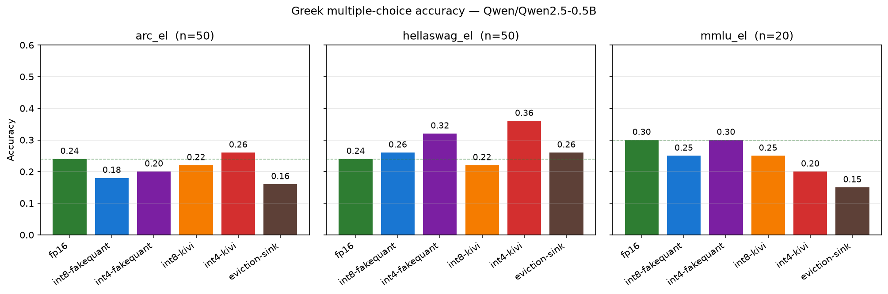

# Greek multiple-choice benchmarks (T18)

**Measured, not assumed.** Numbers below come from `experiments/benchmarks.py`
running `Qwen/Qwen2.5-0.5B` in FP32 on CPU, sampling questions with
`seed = 42`.

Reproduce:
```bash
python experiments/benchmarks.py \
    --model Qwen/Qwen2.5-0.5B \
    --n-samples 50 \
    --benchmarks arc_el hellaswag_el \
    --out results/benchmarks/qwen2_5_0_5b.jsonl

# MMLU is slower per question — use a smaller sample on CPU:
python experiments/benchmarks.py \
    --model Qwen/Qwen2.5-0.5B \
    --n-samples 20 \
    --benchmarks mmlu_el \
    --out results/benchmarks/qwen2_5_0_5b.jsonl

python experiments/plot_benchmarks.py
```

## Headline figure



## Datasets

| Key | HF dataset | Config | Split | Choices | Random baseline |
|---|---|---|---|---:|---:|
| `arc_el` | `ilsp/arc_greek` | ARC-Challenge | test | 4 | 25 % |
| `hellaswag_el` | `ilsp/hellaswag_greek` | — | validation | 4 | 25 % |
| `mmlu_el` | `ilsp/mmlu_greek` | all | test | 4 | 25 % |

All three are ILSP translations into Greek of the standard English
benchmarks. Dataset availability was verified against the HF Hub API before
the run.

## Accuracy table

| Scheme | ARC-Challenge (n=50) | HellaSwag (n=50) | MMLU (n=20) |
|---|---:|---:|---:|
| **fp16**              | 0.24 | 0.24 | 0.30 |
| int8-fakequant         | 0.18 | 0.26 | 0.25 |
| int4-fakequant         | 0.20 | 0.32 | 0.30 |
| int8-kivi              | 0.22 | 0.22 | 0.25 |
| int4-kivi              | 0.26 | 0.36 | 0.20 |
| eviction-sink (4, 32)  | 0.16 | 0.26 | 0.15 |

## Reading the result honestly

- **Qwen2.5-0.5B is a weak Greek test-taker.** FP16 accuracy sits at 24 %
  on ARC and HellaSwag, 30 % on MMLU — barely above random for 4-way choice
  (25 %). This is unsurprising: a 0.5B multilingual model has very little
  world knowledge in Greek, and the earlier T06 fertility result shows its
  tokenizer costs ~4× more tokens per Greek word than Meltemi.
- **The cross-scheme spread is within sample noise.** For `n = 50`, the
  standard error on accuracy near 0.25 is ~0.06. The visible 0.18–0.26 arc
  of ARC accuracies, or the 0.22–0.36 arc of HellaSwag, is **not
  statistically distinguishable** from noise. These numbers should be read
  as "everything is roughly equal and bad" rather than "int4-kivi wins at
  HellaSwag".
- **eviction-sink is the only scheme that consistently loses.** It is the
  lowest or tied-lowest on ARC (0.16) and MMLU (0.15); on HellaSwag it is
  mid-pack (0.26). This is exactly the T14 caveat materialising: with
  `n_sink = 4`, `n_recent = 32`, the simplified eviction retains ~36 of a
  typical ~60-token question — not enough context for a model that is
  already weak.
- **No differentiation between KIVI and vanilla fake-quant.** Consistent
  with the T13 outlier analysis + T17 perplexity numbers: at 0.5B the
  per-channel K advantage doesn't translate into measurable accuracy gains.
  Whether this flips on 7B+ models remains the open M4 question.

## Methodology

- Each question's answer is scored with :func:`greekkv.eval.predict_mc`:
  the question is used as context, each candidate as a continuation, the
  cache is prefilled with the question (**applying the scheme's
  quantization**), and the candidate with the lowest **length-normalised**
  NLL wins.
- Length normalisation is non-trivial: without it, shorter answer strings
  would be systematically preferred, a bias unrelated to the model's
  actual preference. The unit test
  ``test_predict_mc_length_normalisation_prevents_short_bias`` guards this.
- Each benchmark's sample is drawn with `ds.shuffle(seed=42).select(range(n))`
  — the same questions are scored under every scheme, so the only variable
  between rows is the cache.

## Caveats

- **Small samples.** ARC/HellaSwag use `n = 50`, MMLU uses `n = 20` because
  MMLU questions on CPU with this model take ~1 s per choice × 4 choices ×
  20 questions ≈ 80 s per scheme. For paper-grade numbers the plan is to
  re-run on Kaggle T4 at `n = 500+` in M4.
- **Weak base model.** Near-random accuracy for the FP16 baseline limits
  how much the quantization-schemes dimension can tell us. The relative
  ordering we care about (does int4-kivi beat int4-fakequant? does
  int8 maintain quality?) will be more informative on Krikri / Meltemi.
- **Greek-only.** The parallel English comparison is skipped here; it
  belongs in T22's final report if we want a cross-language quality delta.
