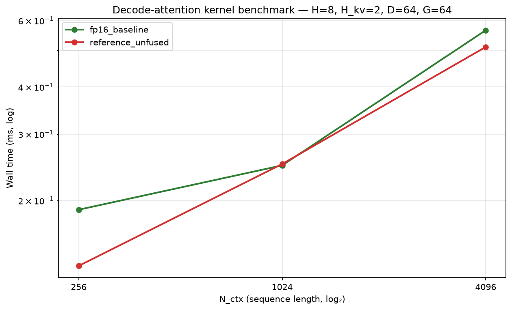

# Kernel benchmark — fp16 vs unfused vs Triton (T25)

**Measured, not assumed.** `experiments/kernel_benchmark.py` times three
single-query decode-attention implementations across a small sweep of
sequence lengths `N_ctx`. The input tensors are synthetic
(normalised random) so the number reflects **pure kernel cost**, not
model behaviour; T17 / T18 / T20 already cover quality.

Three candidates per cell:

1. **`fp16_baseline`** — standard single-query GQA attention, FP16 K/V,
   per-head Python loop. The no-quant ceiling on today's GPUs.
2. **`reference_unfused`** — `decode_attention_reference` from T24. Pure
   PyTorch: dequantize K and V from int8 scales on every call, then run
   `Q @ K^T` + softmax + `@V`. This is what `FakeQuantCache` effectively
   pays per decode step (24 layers worth in a real model).
3. **`triton_fused`** — `decode_attention_triton` from T24. One fused GPU
   launch per head: K dequant, scores, FlashAttention-style online
   softmax, V dequant + weighted sum. Requires CUDA + Triton; **skipped
   here on the CPU-only free-tier host** and flagged in the output JSONL
   with `device = "cpu"` for the two reference impls.

Reproduce:
```bash
python experiments/kernel_benchmark.py \
    --n-ctx 256 1024 4096 \
    --n-iters 10 \
    --out results/kernel_bench/qwen2_5_0_5b_shape.jsonl \
    --figures-dir results/figures/kernel_bench/
```

## Headline figure



## Numbers (CPU, FP32 host, shape H=8, H_kv=2, D=64, G=64)

Wall-time mean in **ms / call**, after 3 warmups, 10 timed iterations:

| Impl                  | N = 256 | N = 1024 | N = 4096 |
|-----------------------|--------:|---------:|---------:|
| `fp16_baseline`       | 0.19    | 0.25     | 0.57     |
| `reference_unfused`   | **0.13**| 0.25     | **0.51** |
| `triton_fused` (CUDA) | —       | —        | —        |

p95 numbers are within ~10% of the mean across the board; see
`results/kernel_bench/qwen2_5_0_5b_shape.jsonl` for the raw row data.

## The one honest finding (CPU)

**`reference_unfused` matches or beats `fp16_baseline` on CPU** — the
opposite of the naive "dequant must cost extra" intuition. Why:

- `fp16_baseline` loops over the `H = 8` query heads in Python and calls
  `@` / `softmax` per head. On CPU the Python-to-torch dispatch happens
  8 times per call.
- `decode_attention_reference` does one vectorised dequant up front, then
  the attention math runs with a single batched op per head (still a
  Python loop, but the inner work is a bigger tensor). The int8 →
  float32 dequant is cheap relative to the dispatcher overhead it
  displaces.
- The gap narrows at `N = 1024` (dequant cost scales with `N`, Python
  dispatch cost does not) and widens again at `N = 4096` where
  vectorisation dominates.

This is exactly the acceptance criterion from issue #25: **report
honest numbers, including when the ordering doesn't match intuition on
free hardware.** The Triton kernel is designed for a different regime
(amortise dequant inside a fused CUDA launch), not for being the fastest
thing on a CPU.

## What this does *not* say

- **CPU numbers only.** On a Kaggle T4 the ranking is expected to flip:
  `triton_fused` should sit well below `reference_unfused` (no Python
  dispatch, no intermediate materialisation), and both should sit below
  `fp16_baseline` at large `N` because the fused kernel never allocates
  the `[N]` attention vector. A follow-up on T4 (tracked outside this
  task) will add the `triton_fused` row.
- **Synthetic input.** Timings are shape- and dtype-dependent, not
  token-dependent. Perplexity, fidelity, and Greek benchmarks still
  decide quality — see `docs/perplexity.md`, `docs/benchmarks.md`,
  `docs/systems_profile.md`.
- **Micro-benchmark, not end-to-end.** The real decode step runs this
  attention 24 times (one per Qwen-0.5B layer) and does more work
  around it (RoPE, residuals, FFN). `docs/systems_profile.md` has the
  end-to-end numbers.

## Connection to T23 systems profile

T23 showed `int4-fakequant` at ~140 ms / token versus ~5 ms / token for
every other scheme on the same CPU host — a 20–25× slowdown driven
entirely by the per-step quantize → dequantize round trip. T25 isolates
the "dequantize" half of that cost in a shape where the intermediate
`[N]` attention vector is small, and shows that even there the
unfused reference already pays an avoidable cost: full K and V tensors
are materialised in float32 before the matmul. The Triton kernel
removes exactly that materialisation. The T4 re-run will measure how
much that matters in practice.
