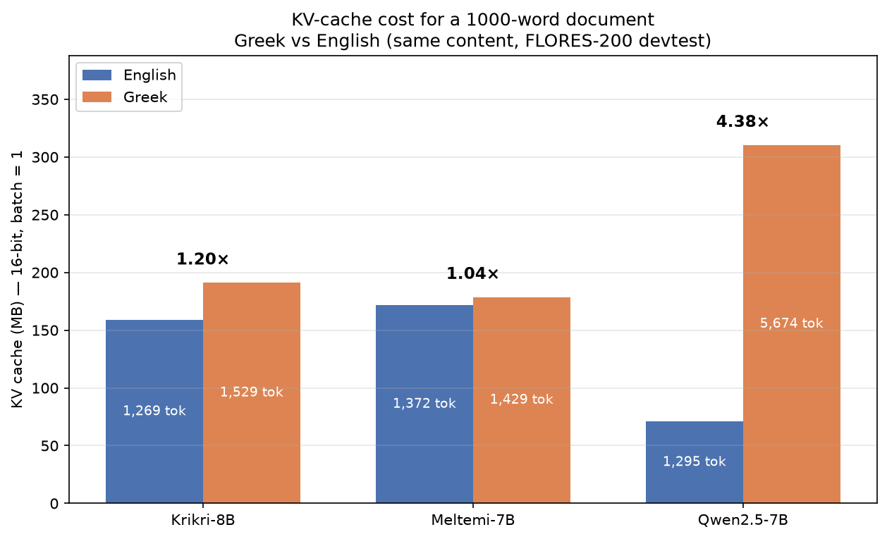

# Greek vs English KV-cache cost (T08)

**Measured, not assumed.** Figure and numbers below come from combining:

- **T06 fertility** (`results/fertility.csv`) — measured tokens-per-word on
  FLORES-200 devtest for each tokenizer.
- **T07 KV formula** — applied to each model's real architecture config
  pulled via `transformers.AutoConfig.from_pretrained`.

## Headline figure



## Reproduce

```bash
# Prerequisite: results/fertility.csv (from T06).
python experiments/plot_kv_cost.py \
    --fertility results/fertility.csv \
    --out       results/figures/kv_greek_vs_english.png \
    --n-words   1000 \
    --bits      16
```

The script also writes `results/figures/kv_greek_vs_english.csv` as a sidecar
with the exact numbers used in the plot (consumed by downstream tasks and the
T30 dashboard).

A thin notebook wrapper is at
[`notebooks/greek_vs_english_kv.ipynb`](../notebooks/greek_vs_english_kv.ipynb).

## Numbers (1000-word document, FP16 cache, batch = 1)

| Model | EN tokens | EN KV (MB) | EL tokens | EL KV (MB) | **EL / EN** |
|---|---:|---:|---:|---:|---:|
| Krikri-8B (Llama, GQA 32:8) | 1,269 | 158.6 | 1,529 | 191.1 | **1.20×** |
| Meltemi-7B (Mistral, GQA 32:8) | 1,372 | 171.5 | 1,429 | 178.6 | **1.04×** |
| Qwen2.5-7B (GQA 28:4) | 1,295 | **70.8** | 5,674 | **310.3** | **4.38×** |

## Reading

Two independent forces drive KV cost per *document* in each column:

1. **Architecture per-token cost** — `2 · L · H_kv · d_head · bytes_per_elem`.
   Fixed once you choose the model. For the three here:
   - Krikri / Meltemi: **128 kB/token** at FP16 (Llama-arch: 32 layers × 8 KV
     heads × 128 d_head × 2 bytes × 2 tensors).
   - Qwen2.5: **56 kB/token** — ~2.3× cheaper per token (fewer layers, fewer
     KV heads).
2. **Tokens per document** — driven by the tokenizer and language, measured in
   T06. Greek costs 1.04× (Meltemi), 1.20× (Krikri), or **4.38×** (Qwen2.5)
   more tokens than English for the same content.

The net KV cost is the product. **In Qwen2.5 the two forces do not cancel — they
compound in the wrong direction:** the architecture is 2.3× cheaper per token,
but the tokenizer uses 4.4× more tokens, so Greek ends up ~1.9× more expensive
*in absolute MB* than the same content on Krikri / Meltemi, despite Qwen2.5
being the cheapest model for English.

## Why this matters

For Greek production at fixed VRAM, the two actionable levers in order of
impact for a Qwen-class model are:

1. **Use a Greek-adapted tokenizer** (Meltemi / Krikri). This is a 4× capacity
   lever.
2. **Then** quantize the KV cache (M3–M5 of this project). This is a 2–4×
   lever on top.

For Krikri / Meltemi the tokenizer lever is already pulled, so the measurable
remaining upside sits almost entirely in KV quantization and GQA.

## Caveats

- Figure is at **batch = 1**. Capacity-model work in M5 sweeps batch.
- Word count uses whitespace tokenization (same convention as T06); it is a
  fair relative metric but not a linguistic "word" count.
- KV formula is for FP16, no cache quantization. T09–T12 add quantized variants;
  T28 combines the two into a capacity curve.
