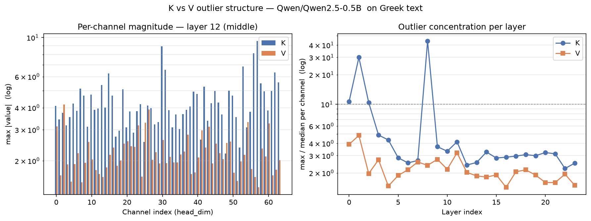

# K / V outlier structure on Greek text (T13)

**Measured, not assumed.** All numbers below come from
`experiments/kv_outlier_analysis.py` running `Qwen/Qwen2.5-0.5B` over 4
articles sampled from Greek Wikipedia (`load_el_wikipedia_sample`, seed = 42),
truncated to a 512-token window.

Reproduce:
```bash
python experiments/kv_outlier_analysis.py \
    --model Qwen/Qwen2.5-0.5B \
    --n-samples 4 --max-tokens 512 --seed 42 \
    --out-json results/kv_outliers.json \
    --out-fig  results/figures/kv_outliers.png
```

## Headline figure



## What's being measured

For every transformer layer we capture the **new** K and V tensors at their
first appearance (via a `CaptureCache` subclass of `DynamicCache`). Each
tensor has shape `[B, H_kv, N, D]` with `B=1`, `H_kv=2`, `N=512`, `D=64` for
this model.

For each layer we compute two reductions:

- **Per-channel max** — `|x|.amax(over (B, H_kv, N))` → a vector of length
  `D`. Tells us whether a few head-dim channels have outsized magnitude.
- **Concentration ratio** — `max(per_channel_max) / median(per_channel_max)`.
  A single scalar summarising "how spiky is the per-channel distribution".

## The finding

**K has a markedly more concentrated magnitude distribution than V — at every
layer, and sometimes by an order of magnitude.**

| Layer | K  max/med | V  max/med |
|------:|-----------:|-----------:|
| 0 | **10.6×** | 3.9× |
| 1 | **30.0×** | 4.8× |
| 2 | **10.4×** | 2.0× |
| 8 | **44.0×** | 2.4× |

(Full per-layer numbers live in `results/kv_outliers.json`.)

- Across **all 24 layers**, K's concentration ratio is **strictly higher
  than V's**. The right-hand panel of the figure shows the two curves
  never cross.
- V's concentration sits in a tight 1.5× – 5× band regardless of depth.
- K's peaks (layers 1 and 8 cross the 10× dashed line in the plot) are
  exactly the "attention sink" layers where a handful of channels dominate.

## Why this matters for quantization

A group-wise quantizer picks one scale per group. **The scale is set by the
largest magnitude in the group** (symmetric) or by the range (asymmetric).
When one channel in a group has a 44× outlier, the scale is pulled up to
cover it, which widens the quantization step for every other element in the
group and destroys precision for the common values.

Two realistic layouts for the KV cache:

- **Per-channel K** (KIVI). Groups are formed **along the head-dim axis** and
  scales are shared **across sequence positions**. An outlier channel's
  inflated scale is confined to that channel's group; the vast majority of
  the tensor keeps a tight scale that matches the common-case magnitude. The
  measurements here (K concentration ≫ V concentration) are the empirical
  justification: the outliers live along channels, so grouping along channels
  isolates them.
- **Per-token V** (also KIVI). Groups are formed **along the sequence axis**
  and scales shared **across head_dim**. Our V stats show no channel
  concentration — the dynamic range is driven by *which position* a value
  belongs to, not which channel. So sharing the scale across channels is
  cheap, and per-token tracks the per-position variation that does exist.

**Bottom line:** the KIVI layout is not a stylistic choice — for Qwen2.5 on
Greek, it is the layout that *matches the data*. HF's `QuantizedCache` (our
`quanto` / `hqq` adapter) uses per-channel for *both* K and V, which from
this analysis predicts a measurable V-side penalty vs KIVI. T17 (perplexity)
and T20 (fidelity) will settle whether the predicted penalty is visible in
end-to-end quality.

## Caveats

- **One model (Qwen2.5-0.5B), one language (Greek), one slice (512 tokens).**
  The qualitative pattern (K outlier-heavy, V diffuse) is well-documented in
  the literature for transformer-family models of various sizes, but the
  exact numbers above don't claim to generalise to Llama-arch or to English
  text. Extending to Krikri / Meltemi is on the roadmap for M4 once the
  free-tier memory budget allows loading them.
- **Outlier concentration is a *necessary* but not *sufficient* condition for
  "per-channel will help".** It argues the ceiling of achievable quality;
  whether per-channel pays off depends on whether the scheme's extra overhead
  (one scale per channel group instead of per token) is justified for your
  context length. T17 / T18 measure this end-to-end.
