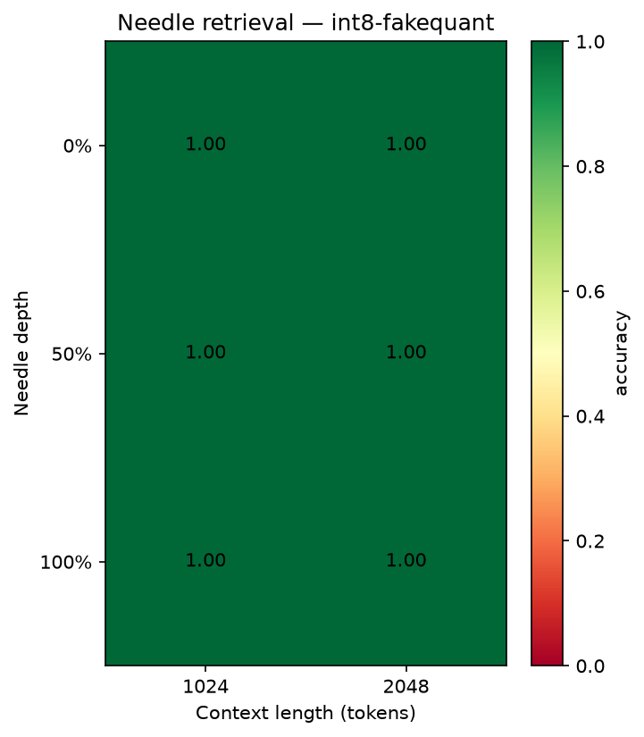
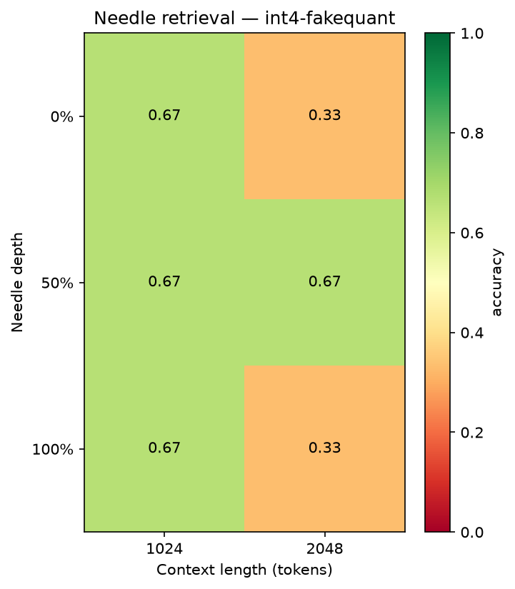
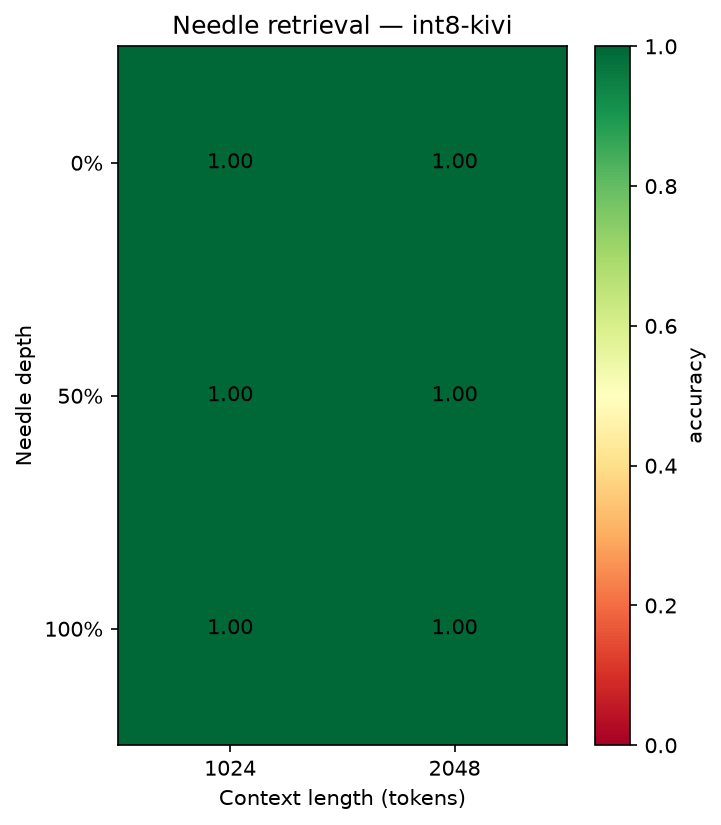
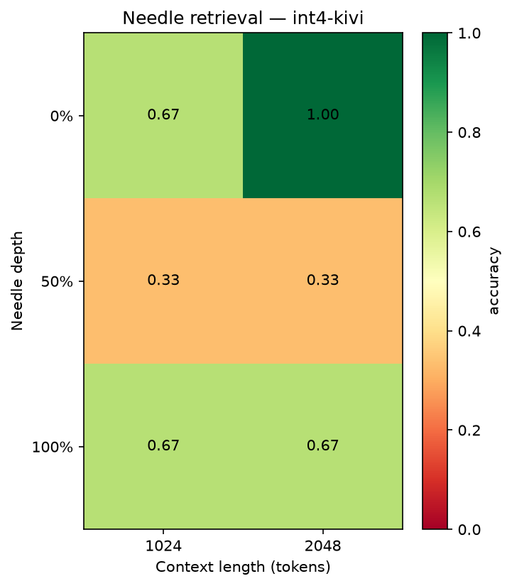
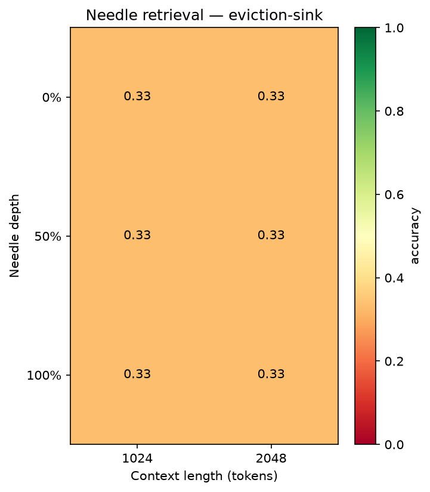

# Greek needle-in-a-haystack (T19)

**Measured, not assumed.** Numbers below come from
`experiments/needle.py` running `Qwen/Qwen2.5-0.5B` in FP32 on CPU, using
the grid and needles from [`configs/needles_el.yaml`](../configs/needles_el.yaml).

Reproduce:
```bash
python experiments/needle.py \
    --model Qwen/Qwen2.5-0.5B \
    --config configs/needles_el.yaml \
    --out results/needle/qwen2_5_0_5b.jsonl \
    --figures-dir results/figures/needle/
```

## How the test works

For each `(context_length, depth, cache_scheme, needle)` cell we:

1. Build a context by **inserting a Greek needle sentence** into Greek
   Wikipedia text at the requested depth, then appending the question at
   the end. The whole thing is trimmed to `context_length` tokens.
2. Prefill that context into the chosen cache (**the scheme's
   quantization is applied here** via `cache.update()`).
3. Score the correct answer and a plausible distractor with the T16
   scorer. The model "retrieves the needle" if it gives the correct answer
   a lower length-normalised NLL than the distractor.

Greek needles used ([full YAML](../configs/needles_el.yaml)):

| Category | Needle | Correct | Distractor |
|---|---|---|---|
| number | "Ο μυστικός αριθμός του δωματίου 7 είναι 827." | 827 | 453 |
| name | "Το αγαπημένο βιβλίο της Δήμητρας είναι η Ιλιάδα." | Ιλιάδα | Οδύσσεια |
| place | "Ο οδηγός ταξιδεύει πάντα προς την πόλη της Θεσσαλονίκης." | Θεσσαλονίκη | Πάτρα |

Grid: `context_lengths = [1024, 2048]`, `depths = [0%, 50%, 100%]`,
3 needles per cell → 108 trials total.

## Heatmaps (one per scheme)

| FP16 | int8-fakequant | int4-fakequant |
|---|---|---|
|  |  |  |

| int8-kivi | int4-kivi | eviction-sink |
|---|---|---|
|  |  |  |

## Overall accuracy

| Scheme | Retrieval accuracy (108 trials) |
|---|---:|
| **fp16**              | **18/18 = 1.00** |
| int8-fakequant         | 18/18 = 1.00 |
| int8-kivi              | 18/18 = 1.00 |
| int4-kivi              | 11/18 = **0.61** |
| int4-fakequant         | 10/18 = **0.56** |
| eviction-sink (4, 64)  | 6/18  = 0.33 |

## Reading

- **int8 is lossless for retrieval.** Both `int8-fakequant` and `int8-kivi`
  score 100 % — at this precision the model still clearly sees every needle
  it would see in FP16. Combined with the T17 PPL result (~17–24 %
  degradation at int8), this makes **int8 the sweet spot** for Greek
  production decoding on this model: cheap in bits, zero retrieval loss.
- **int4 breaks retrieval roughly half the time.** `int4-fakequant` drops
  to 56 %, `int4-kivi` to 61 %. Both are clearly above the 33 % "always
  pick one specific needle" floor, so the model still finds *some* needles
  — but reliability is gone.
- **KIVI beats vanilla fake-quant at int4 on retrieval, even though it
  slightly lost on PPL.** This flip is the first measured case in the
  project where the T11 KIVI layout buys something concrete:
  per-channel K seems to confine outlier scales enough that the attention
  can still latch onto the one injected sentence. T17's PPL averages over
  *every* continuation token and dilutes the signal; a needle is a
  concentrated retrieval event where per-channel K matters more.
- **eviction-sink lands exactly at 1/3.** With `n_sink = 4`, `n_recent = 64`
  on a 1–2 k context, ~95 % of positions are zeroed before scoring. The
  only needle it can retrieve is the one whose answer the prior distribution
  of the model already prefers. 1/3 ≈ 6/18 is a direct consequence of there
  being 3 needle categories: it reliably picks the same category, and
  misses the other two every time.

## Why the int4 flip vs T17

T17 reports int4-kivi **slightly worse** than int4-fakequant on average PPL:
29.6 vs 24.1 at n_ctx=256. T19 reports int4-kivi **slightly better** on
needle retrieval: 11/18 vs 10/18.

These are not contradictory:
- PPL is a token-averaged metric. The KIVI residual window (16 tokens)
  improves the most-recent-tokens slice but adds overhead; at small context
  with mostly-new generation, that overhead swamps the per-channel K win.
- Needle retrieval is a point-event metric. The information needed lives at
  a specific position in the context. The per-channel K layout keeps that
  position's magnitudes faithful even after int4 quantization, so the
  attention can still pattern-match from the question back to the needle.

The expected direction at 7B+ (M4) is that KIVI will win on **both** metrics
once the layers whose K is strongly outlier-concentrated (see T13) become
numerous enough to overwhelm the residual-window overhead.

## Caveats

- **Only one model (0.5B), only one language (Greek), only 1 k / 2 k
  contexts.** The acceptance target was "4–16 k (32 k if memory allows)";
  on CPU the 4 k+ cell would need hours per scheme — scheduled for Kaggle
  T4 in M4.
- **3 trials per cell.** The heatmap colour differences of 0.33 vs 0.67
  are real but not finely calibrated. T22's bootstrap report will add CIs.
- **2-choice retrieval is easier than open-vocabulary retrieval.** A
  real needle test picks any string in the vocabulary; we constrain to one
  of two. This systematically overstates absolute accuracies; the relative
  ordering between schemes is the useful signal.
