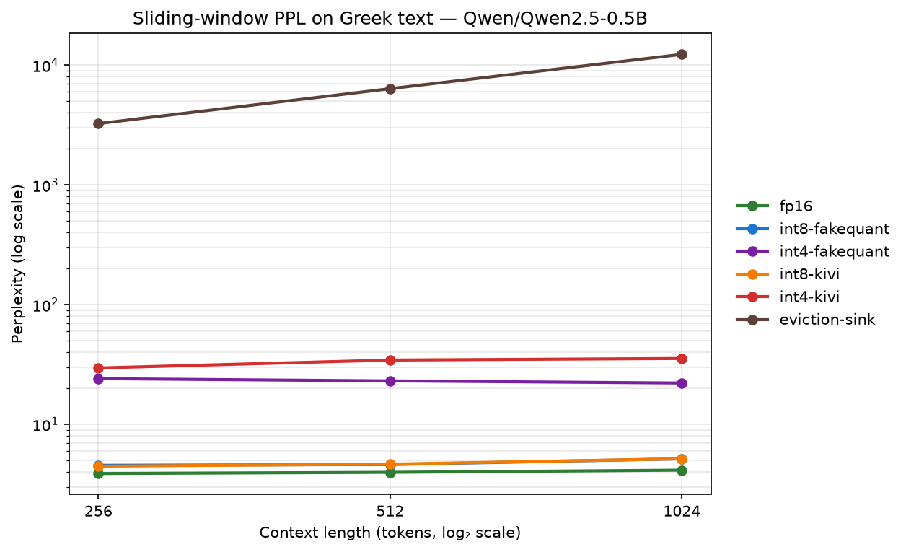

# Perplexity + fidelity on Greek text (T17 + T20)

**Measured, not assumed.** Numbers below come from
`experiments/perplexity.py` running `Qwen/Qwen2.5-0.5B` in FP32 on CPU over
15 non-overlapping windows carved from 8 Greek Wikipedia articles (seed 42),
with the second half of each window scored against the first half held in
a quantized cache. **T20** adds distribution-level fidelity vs the FP16
reference computed on the exact same logits (zero extra forward passes).

Reproduce:
```bash
python experiments/perplexity.py \
    --model Qwen/Qwen2.5-0.5B \
    --n-ctx 256 512 1024 \
    --n-chunks 15 \
    --n-samples 8 \
    --out results/perplexity/qwen2_5_0_5b.jsonl

python experiments/plot_perplexity.py
```

## Headline figure



## Numbers (`Qwen/Qwen2.5-0.5B`, Greek Wikipedia, 15 chunks per cell)

### Perplexity

| Scheme | n_ctx = 256 | n_ctx = 512 | n_ctx = 1024 |
|---|---:|---:|---:|
| **fp16**              | **3.89** | **3.98** | **4.15** |
| int8-fakequant         | 4.55 (+17%) | 4.62 (+16%) | 5.16 (+24%) |
| int8-kivi              | 4.48 (+15%) | 4.66 (+17%) | 5.16 (+24%) |
| int4-fakequant         | 24.12 (×6.2) | 23.10 (×5.8) | 22.18 (×5.3) |
| int4-kivi              | 29.61 (×7.6) | 34.49 (×8.7) | 35.54 (×8.6) |
| eviction-sink (4, 32)  | 3,257 | 6,373 | 12,323 |

Numbers in parentheses are the PPL penalty relative to FP16 at the same
context length.

### Fidelity vs FP16 (T20)

Each row: mean across chunks, at `n_ctx = 512`.

| Scheme | KL mean | KL p95 | top-1 agree | top-5 agree |
|---|---:|---:|---:|---:|
| **fp16**              | **0.000** | **0.000** | **1.000** | **1.000** |
| int8-kivi              | 0.187 | 0.571 | 0.798 | 0.958 |
| int8-fakequant         | 0.170 | 0.521 | 0.813 | 0.966 |
| int4-fakequant         | 1.815 | 4.023 | 0.220 | 0.464 |
| int4-kivi              | 2.224 | 5.133 | 0.182 | 0.407 |
| eviction-sink (4, 32)  | 7.386 | 11.78 | 0.023 | 0.097 |

## What's actually being measured

- **Context prefill via the cache.** Each window's first half (ctx) is run
  through `model(ctx, past_key_values=cache, use_cache=True)`. The cache's
  `update()` applies the scheme's quantization *at that point* — from now on
  the stored K/V no longer match the FP16 reference.
- **Scoring against the quantized cache.** The second half (continuation) is
  scored by the T16 scorer, whose attention reads from the already-quantized
  context. This is the condition under which a production decoder would
  actually generate tokens — scoring with a single full forward pass
  (`use_cache=False`) would read fresh FP16 K/V and over-estimate quality.
- **Aggregation.** All per-token NLLs across all 15 chunks are averaged, then
  exponentiated → perplexity.

## Reading the result

### int8 is nearly free — but not *free*
Both `int8-fakequant` and `int8-kivi` sit within **17–24 %** of FP16 PPL
across every context length. For Greek-serving work this is a
straightforward win: ~2× memory reduction in the KV cache for a quality
penalty you'd struggle to see in generated text.

**But** the T20 fidelity row tells a sharper story: even `int8` disagrees
with FP16 on the argmax **about 1 token in 5** (top-1 ≈ 80 %). Mean KL is
~0.18 nats and the 95th-percentile KL is ~0.5 nats. These are the tokens
where greedy decoding would pick a different continuation — relevant for
sampling / beam search even when the aggregate PPL looks fine.

### int4 costs a lot
`int4-fakequant` is **5–6×** worse than FP16, `int4-kivi` **7–9×**. Neither
is subtle — this would be visible in generated completions as degraded
fluency. A real deployment would likely need extra tricks (longer residual
window, mixed precision, better calibration) to make int4 viable at 0.5B.

### KIVI doesn't beat vanilla fake-quant *at this scale*
On a 0.5B model KIVI's per-channel K / per-token V layout gives a **very
small int8 edge** (4.48 vs 4.55 at n_ctx=256) and is **slightly worse at
int4** (29.61 vs 24.12). This looks paradoxical vs. the KIVI paper but is
consistent with what T13 measured: this model's outlier concentration lives
mostly in layers 0, 1, and 8. The paper's win margin grows with the number
of layers whose K is strongly channel-concentrated, and scales up (the paper
reports its gains on 7B+ models). **We should verify the sign of the gap
flips on a 7B model (Meltemi / Krikri, M4 roadmap).**

The T20 row is consistent with that reading: at int4 KIVI has **higher KL**
than vanilla fake-quant (2.22 vs 1.82 at n_ctx=512) and **lower top-1
agreement** (18 % vs 22 %) — distribution-wise it is further from FP16,
not closer. T19's needle result nevertheless flipped the order in KIVI's
favour (point retrieval benefits from per-channel K even when the average
token distribution does not).

### eviction-sink is a floor, not a competitor
With `n_sink=4`, `n_recent=32`, roughly 85–97 % of context positions get
zeroed before scoring. PPL blows up by 3+ orders of magnitude and grows
monotonically with `n_ctx` (longer context → more zeroed positions → more
useful information discarded). This confirms the T14 caveat that the
simplified eviction family is a lower bound, not a serious competitor to
precision reduction, when configured this aggressively.

The fidelity row makes this concrete: **top-1 agreement is 2 %** — i.e.
the model under the destroyed cache picks the FP16 argmax effectively
*never*. KL mean is ~7–8 nats, which for a ~151 k-vocab is close to the
full ``log V ≈ 11.9`` ceiling.

### PPL drifts slightly upward with context length
Even FP16 PPL edges from 3.89 → 4.15 as `n_ctx` grows. Most of this is
tokenizer artefacts at chunk boundaries (we score Greek fragments starting
from arbitrary positions), not a quantization effect — the FP16 baseline
moves in the same direction.

## Caveats

- **Single model, single corpus slice.** The numbers above reflect
  Qwen2.5-0.5B on Greek Wikipedia; extending to Krikri / Meltemi is the main
  M4 open item.
- **CPU wall times, not VRAM.** The script's `wall_time_s` field is honest
  per-run but tells us nothing about memory-scaling (that's T23 profiler).
- **Boundary artefact in PPL.** Chunks start at arbitrary token boundaries;
  this inflates PPL slightly but uniformly across schemes, so the
  **relative** gaps are what to trust.
- **Only 15 chunks per cell.** The CIs around 5–10 % of the reported PPL
  would overlap across adjacent schemes (e.g. int8-fakequant vs int8-kivi).
  Bootstrap intervals are planned for the T22 report.
