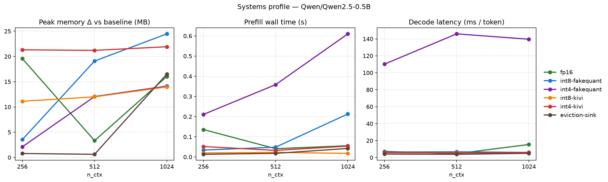

# Systems profile — memory + latency (T23)

**Measured, not assumed.** `experiments/systems_profile.py` prefills
`n_ctx` random tokens into a cache, then decodes 16 more one-token
steps against the already-quantized cache. Three numbers per
`(scheme, n_ctx)` cell:

- **Peak memory Δ vs baseline** — on CPU, max resident-set-size above
  the post-load baseline (`psutil.Process().memory_info().rss`). On CUDA,
  `torch.cuda.max_memory_allocated()` minus the baseline allocator state.
- **Prefill wall time** — one `n_ctx`-token forward pass.
- **Decode latency** — average ms per new token over the 16 decoding steps.

Reproduce:
```bash
python experiments/systems_profile.py \
    --model Qwen/Qwen2.5-0.5B \
    --n-ctx 256 512 1024 \
    --n-decode 16 \
    --out results/profile/qwen2_5_0_5b.jsonl \
    --figures-dir results/figures/profile/
```

## Headline figure



## Numbers (Qwen2.5-0.5B, FP32 CPU, n_decode = 16)

Decode latency in **ms / token** (higher = slower):

| Scheme | n_ctx = 256 | 512 | 1024 |
|---|---:|---:|---:|
| **fp16**              | 5.8   | 4.6   | 15.4  |
| int8-fakequant         | 5.8   | 6.8   | 6.0   |
| int4-fakequant         | **110** | **146** | **140** |
| int8-kivi              | 5.4   | 5.6   | 5.3   |
| int4-kivi              | 5.6   | 5.3   | 5.9   |
| eviction-sink (4, 32)  | 4.1   | 3.8   | 5.0   |

Decode throughput (tokens / second):

| Scheme | 256 | 512 | 1024 |
|---|---:|---:|---:|
| fp16                   | 173  | 219  | 65   |
| int8-fakequant         | 172  | 148  | 166  |
| **int4-fakequant**     | **9** | **7** | **7** |
| int8-kivi              | 185  | 179  | 189  |
| int4-kivi              | 179  | 187  | 169  |
| eviction-sink          | 244  | 261  | 202  |

## The one big finding

**`int4-fakequant` decodes ~20–25× slower than every other scheme** on
this model (~140 ms/token vs ~5 ms/token). The cause is architectural,
not a measurement artefact:

- `FakeQuantCache.update()` runs a full `quantize → dequantize` pass on
  every layer's new K and V at every decode step.
- At `bits = 4`, that includes `pack_int4` + `unpack_int4` bit-ops and
  a reshape through per-group scales — tiny-tensor operations that hit
  the Python / torch op dispatcher 24 layers × 2 tensors × 2 ops =
  ~96 times per step. On CPU that dispatch overhead dominates.
- `int8-fakequant` skips the bit-packing round trip, so the overhead
  collapses back to "one tiny quantize round trip per layer" — barely
  above FP16.
- **KIVI avoids this because new tokens live in the FP16 residual
  window.** Quantization fires only on eviction, which is rare at these
  context lengths. That's why `int4-kivi` decodes at FP16 speeds while
  still applying int4 to the evicted tail.

## Implications for the T28 capacity model

- The T17 PPL penalty at int4 (~5–9×) and the T23 decode throughput
  penalty (~20× for fake-quant) multiply through:
  **"int4 everywhere" is not a free quality–vs–capacity trade on
  current CPU execution.** Real deployments need either the T24 Triton
  kernel (to amortize the dispatch overhead) or KIVI-style selective
  eviction (which this project already exposes).
- The `eviction-sink` scheme is the fastest decode across the board, but
  the T17 and T18 quality rows disqualify it as a serious competitor
  under these settings. It stays in the sweep as a floor.

## Caveats

- **CPU numbers only.** The real serving targets are Kaggle T4 and
  comparable GPUs, where CUDA kernels + fused ops shift the picture.
  The M4 re-run will re-collect these numbers on T4.
- **Random tokens.** Latency does not depend on token content for
  these schemes; PPL / fidelity are measured separately in T17 / T20.
- **Baseline-delta memory accounting.** On CPU the reported peak is RSS
  above the post-load baseline, so python runtime, torch, and Qwen's
  resident weights are *not* in the delta. For absolute footprints see
  the `peak_mem_mb` field in the JSONL.
